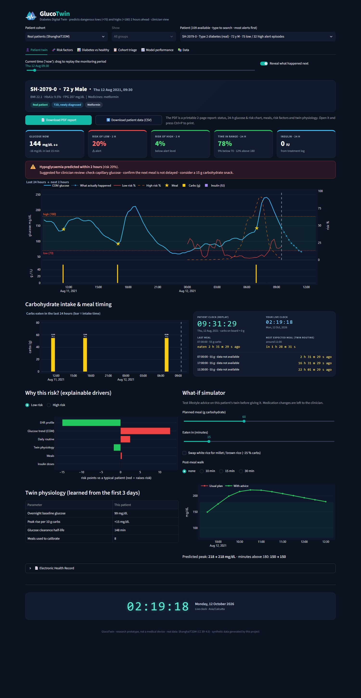
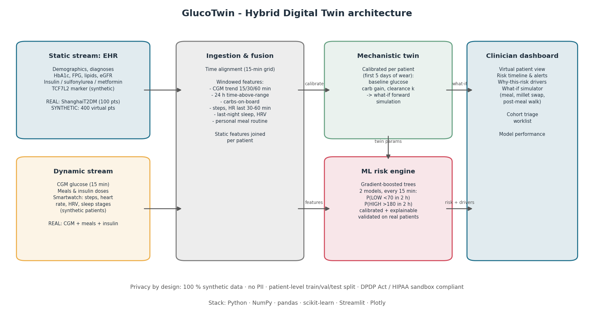
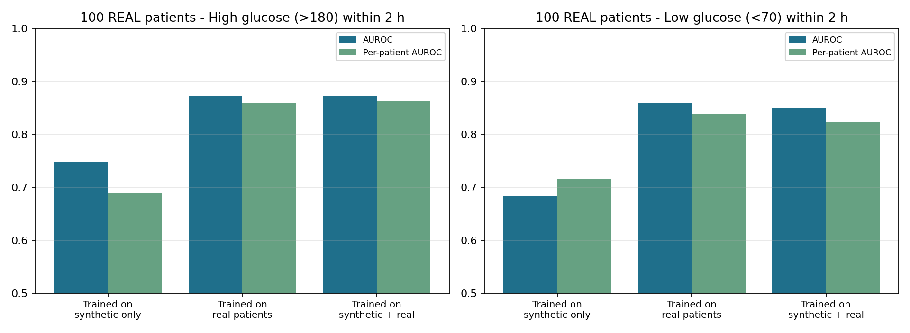
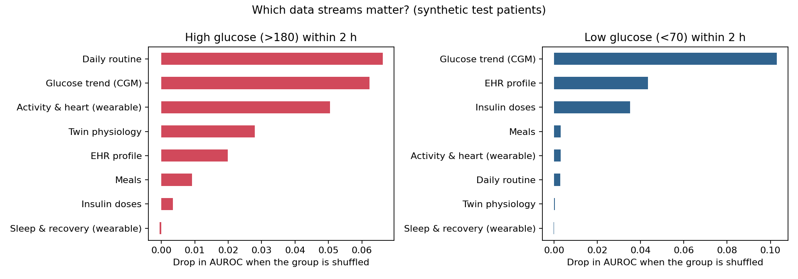

# GlucoTwin — a Digital Twin that warns of dangerous glucose lows and highs 2 hours ahead

> Submission for the **Happiest Health Digital Twin Challenge 2026** (Reimagining and Reforming Healthcare in India Summit, Bengaluru)
>
> **Validated on 100 real patients with Type 2 Diabetes**, not just synthetic data.



*Above: a real patient at 09:15. GlucoTwin raises a hypoglycaemia alert (32 % risk). The dotted line shows what really happened next: glucose fell below 70 mg/dL about 1.5 hours later.*

## Submission quick links

| Item | Link |
|---|---|
| 🎥 **Demo video (15–20 min, unlisted YouTube)** | _Video link to be added_ |
| 🏗️ **Architecture diagram (PDF)** | [docs/architecture.pdf](docs/architecture.pdf) |
| 📊 **Presentation (PDF)** — project details and outcomes | [docs/presentation.pdf](docs/presentation.pdf) |
| 📜 **Open-source license** | [MIT License](LICENSE) — see [section 13](#13-open-source-license) |

All files in this repository and all links above are publicly accessible; no sign-in or access request is needed.

## 1. Team details

| | |
|---|---|
| **Team name** | GlucoTwin |
| **Team leader** | Aditya Jaggal — B.E. Computer Science and Business Systems (CSBS), 4th year |
| **Team size** | 1 (solo participant) |

## 2. College / Incubator information

| | |
|---|---|
| **College** | Dr. Ambedkar Institute of Technology (Dr. AIT), Bengaluru, Karnataka |
| **Department** | Computer Science and Business Systems (CSBS) |
| **Incubator** | Not applicable (student team) |

## 3. Project title

**GlucoTwin: a hybrid mechanistic + machine-learning Digital Twin that predicts hypoglycaemia and hyperglycaemia 2 hours ahead in Type 2 Diabetes**

## 4. Problem statement and healthcare use case

### Problem statement

India has about **101 million people with diabetes** (ICMR-INDIAB, 2023). Two kinds of glucose events cause most of the harm:

- **Lows (hypoglycaemia, < 70 mg/dL).** Usually caused by insulin or sulfonylureas, especially when a meal is skipped or delayed. They lead to dizziness, falls, seizures, emergency visits and even death, and older patients are most at risk.
- **Highs (hyperglycaemia, > 180 mg/dL).** Repeated after-meal spikes, common with rice-heavy diets, raise HbA1c and drive kidney, eye, nerve and heart damage.

Care is still **reactive**: an HbA1c test every three months and the occasional glucometer reading. Continuous glucose monitors (CGMs) and smartwatches now produce data every few minutes, but nobody turns that data into **foresight** for the doctor.

### Healthcare use case

A diabetologist remotely monitors a panel of patients who wear a CGM, and optionally a smartwatch. Every 15 minutes GlucoTwin:

1. **Predicts** the probability of a **low (< 70)** and of a **high (> 180)** within the next 2 hours.
2. **Explains** which data stream drives each alert: CGM trend, meals, insulin doses, routine, EHR, twin physiology, or wearables.
3. **Profiles risk factors**: each patient's HbA1c, BMI, kidney function, medicines, time in range and more are flagged against healthy reference values, and compared with healthy, prediabetes and diabetes groups.
4. **Simulates**: each patient's twin is calibrated on their own data and tests lifestyle advice before it's given (portion size, rice → millet swap, post-meal walk). Medication changes are always left to the clinician.
5. **Tracks meal timing live**: a carbs chart shows each intake time, and a live panel ticks (hh:mm:ss) how long ago the last meal was eaten and how long until the next meal the twin expects. A live digital clock sits at the bottom of the page.
6. **Generates reports**: a printable 2-page PDF report per patient, plus CSV downloads of the patient timeline and the worklist.
7. **Triages**: a worklist ranks the whole panel by current low and high risk.

## 5. How the Digital Twin works (architecture)



📄 **Full architecture diagram (PDF):** [docs/architecture.pdf](docs/architecture.pdf)

### Two data sources, one pipeline

| | **Real patients: ShanghaiT2DM** | **Synthetic patients (this project)** |
|---|---|---|
| Who | 100 people with T2D (109 recordings, ~13 days each) | 400 virtual Indian adults × 14 days |
| Static / EHR | age, sex, BMI, diabetes duration, HbA1c, fasting glucose, lipids, eGFR, complications, medicines | same fields, plus waist, blood pressure, family history, **TCF7L2** genetic marker |
| Dynamic | CGM (15 min), meals with food weights, insulin doses, oral drugs | CGM, meals, insulin, **smartwatch: steps, heart rate, HRV, sleep stages** |
| Role | **validation on real people** | development, plus showing the value of smartwatch data |

Both sources are converted into one shared format ([records.py](glucotwin/records.py)): a 15-minute timeline plus an EHR snapshot. Everything downstream is identical.

**Real data** ([real_data.py](glucotwin/real_data.py)). Zhao Q. *et al.*, *Scientific Data* 10, 35 (2023), CC BY 4.0. Only the English columns are used. Carbohydrates are estimated from food weights with a food-composition lookup, and insulin doses are parsed from free text such as "insulin aspart 70/30, 14 IU".

**Synthetic data** ([simulator.py](glucotwin/simulator.py)). A physiological simulator in which each virtual patient has hidden insulin sensitivity, beta-cell function and carb response. Glucose responds to:

- Indian meal patterns: rice-heavy lunch, chai snack, late dinner, feast days
- each patient's own eating schedule
- **insulin and sulfonylurea action**, including skipped or delayed meals after a dose, which is the classic cause of lows
- missed doses, exercise, sleep debt, stress and the dawn phenomenon
- the body's own protection against lows (counter-regulation)

The smartwatch reacts physiologically: heart rate rises and HRV falls during a low. Lab values such as HbA1c are derived from the simulated glucose, so the two streams stay consistent.

## 6. AI/ML model and framework details

**Model type:** hybrid Digital Twin = per-patient mechanistic physiology model + two calibrated gradient-boosted tree classifiers. **Framework:** scikit-learn (`HistGradientBoostingClassifier`; Platt scaling via `LogisticRegression` on held-out patients; `GroupKFold`), NumPy least-squares for twin calibration. **Prediction targets:** P(glucose < 70 mg/dL within 2 h) and P(glucose > 180 mg/dL within 2 h), refreshed every 15 minutes. **Validation:** 5-fold cross-validation grouped by patient on 100 real T2D patients.

- **Mechanistic layer** ([twin.py](glucotwin/twin.py)): during the first days of wear, each patient's twin learns a personal overnight baseline, carb gain and glucose clearance rate. It fits a gamma-absorption → first-order-clearance model to that patient's own post-meal CGM curves, and also learns their personal meal routine. The calibrated twin powers the **what-if simulator** and feeds the ML layer.
- **ML layer** ([model.py](glucotwin/model.py), [features.py](glucotwin/features.py)): two gradient-boosted tree classifiers (scikit-learn `HistGradientBoostingClassifier`), one for **lows** and one for **highs**. They use up to 60 fused features: CGM trend, carbs on board, insulin on board, routine, EHR, twin parameters and wearables. On real patients, 43 of those features are available. Probabilities are **calibrated** (Platt scaling on held-out patients), so a displayed "30 %" means roughly 30 %.
- **Explainability**: each prediction is broken down by feature group ("risk points vs a typical patient"), and group permutation importance is computed across the cohort.

## 7. Results

### 7a. Real patients: 5-fold cross-validation grouped by patient

Every real patient's predictions come from a model that **never saw that patient**. Alert thresholds and calibration are chosen on separate held-out patients inside each training fold.

**Lows: glucose < 70 mg/dL within 2 hours** (315 real low episodes)

| Training strategy | AUROC | Per-patient AUROC* | Lows warned | Median warning | Warned ≥ 30 min | False alerts / patient-day |
|---|---|---|---|---|---|---|
| Trained on synthetic only | 0.683 | 0.715 | 14.9 % | 15 min | 5.4 % | 0.13 |
| **Trained on real patients** (used in dashboard) | **0.859** | **0.839** | **81.3 %** | **75 min** | **69.2 %** | 1.25 |
| Trained on synthetic + real | 0.849 | 0.823 | 87.3 % | 90 min | 75.9 % | 1.66 |

**Highs: glucose > 180 mg/dL within 2 hours** (1,482 real spike episodes)

| Training strategy | AUROC | Per-patient AUROC* | Spikes warned | Median warning | Warned ≥ 30 min | False alerts / patient-day |
|---|---|---|---|---|---|---|
| Trained on synthetic only | 0.748 | 0.690 | 69.5 % | 60 min | 55.1 % | 1.69 |
| Trained on real patients | 0.872 | 0.859 | 91.1 % | 90 min | 79.2 % | 1.85 |
| **Trained on synthetic + real** (used in dashboard) | **0.873** | **0.863** | **93.2 %** | **90 min** | **82.6 %** | 1.95 |

\*Per-patient AUROC is the median AUROC computed *within* each patient. It checks whether the model knows *when* an event is coming, not just *who* is a high-risk patient.



### 7b. Synthetic cohort: what does each data stream add? (60 held-out patients)

| Lows (< 70) | AUROC | Per-patient AUROC | Lows warned | False alerts / day |
|---|---|---|---|---|
| EHR only | 0.952 | 0.818 | 50.0 % | 0.17 |
| CGM + wearables only | 0.981 | 0.962 | 80.8 % | 0.19 |
| EHR + CGM + wearables | 0.985 | 0.961 | 86.5 % | 0.20 |
| **GlucoTwin (all + twin)** | **0.985** | **0.970** | **86.5 %** | **0.14** |

| Highs (> 180) | AUROC | Per-patient AUROC | Spikes warned | False alerts / day |
|---|---|---|---|---|
| EHR only | 0.882 | 0.852 | 80.5 % | 1.35 |
| CGM + wearables only | 0.927 | 0.892 | 94.8 % | 1.22 |
| EHR + CGM + wearables | 0.929 | 0.900 | 95.2 % | 1.33 |
| **GlucoTwin (all + twin)** | **0.927** | **0.903** | **93.8 %** | **1.24** |



### What the results mean

- **On real patients, GlucoTwin warns of 81 % of dangerous lows, a median 75 minutes in advance**, and of 93 % of spikes, a median 90 minutes in advance.
- **EHR alone knows *who* is at risk, not *when*.** For lows on synthetic patients it scores a high AUROC (0.95), but per-patient AUROC drops to 0.82 and it catches only 50 % of lows. Adding live CGM and wearable data lifts warnings to 86.5 %. Fusing both streams matters.
- **The twin's physiology cuts false low alerts by ~30 %** (0.20 → 0.14 per day) at the same detection rate.
- **Synthetic data alone is not enough.** A model trained only on simulated patients transfers poorly to real hospital patients (AUROC 0.68 for lows). That is exactly why we validate on real data, and it's an honest lesson for any Digital Twin built on synthetic data.

### Honest limitations

- The real cohort is Chinese and mostly hospitalised, not Indian outpatients. The next step is validation on Indian CGM data.
- The real data has **no smartwatch stream**, so the added value of wearables is shown on synthetic patients only.
- Low alerts on real patients are precise about 1 time in 5 (PPV ≈ 0.20), with ~1.25 false alerts per patient-day. That's acceptable for a "check your glucose" nudge, not for automatic treatment.
- Carbohydrates in the real data are estimated from food weights.
- This is a research prototype, **not a medical device**.

## 8. Technical stack

| Layer | Technology |
|---|---|
| Language | Python 3.11 |
| Data | NumPy, pandas, openpyxl/xlrd (real Excel files) |
| Synthetic patients | Custom physiological simulator (meals, insulin/sulfonylurea, counter-regulation, sleep, stress) |
| Digital twin | Gamma-absorption + first-order-clearance model, least-squares calibration per patient |
| ML | scikit-learn `HistGradientBoostingClassifier` + Platt calibration; patient-grouped `GroupKFold` |
| Explainability | Feature-group ablation (per prediction) + grouped permutation importance |
| Dashboard | Streamlit + Plotly |
| Reports | Matplotlib (architecture diagram, slides, figures) |

## 9. Demo video, architecture diagram and presentation

| Deliverable | Link |
|---|---|
| 🎥 Demo video (15–20 min, unlisted YouTube) | _Video link to be added_ |
| 🏗️ Architecture diagram (PDF) | [docs/architecture.pdf](docs/architecture.pdf) |
| 📊 Presentation (PDF): project details and outcomes | [docs/presentation.pdf](docs/presentation.pdf) |

## 10. Run it

```bash
pip install -r requirements.txt
python data/download_real_data.py   # fetches ShanghaiT2DM (3.7 MB, checksum-verified)
python run_pipeline.py              # simulate, calibrate twins, train, validate (~30 min)
python make_comparison.py           # healthy vs diabetes comparison data for the dashboard
python make_demo_patients.py        # add 45 fresh, never-seen patients (15 healthy / 15 prediabetes / 15 T2D)
python docs/make_docs.py            # rebuild architecture.pdf and presentation.pdf
streamlit run app.py                # clinician dashboard at http://localhost:8501
```

`python run_pipeline.py --quick` runs a smaller smoke test (~10 min). Results can be reproduced from a fixed seed (`--seed 7`).

## 11. Repository layout

```
GlucoTwin/
├── app.py                     # clinician dashboard (Streamlit)
├── run_pipeline.py            # end-to-end pipeline
├── make_comparison.py         # healthy vs diabetes comparison data
├── make_demo_patients.py      # fresh never-seen patients for the dashboard
├── glucotwin/
│   ├── simulator.py           # synthetic EHR + CGM + smartwatch generator
│   ├── real_data.py           # ShanghaiT2DM loader (meals -> carbs, insulin parsing)
│   ├── records.py             # shared 15-min patient format
│   ├── twin.py                # mechanistic twin: calibration & what-if forecast
│   ├── features.py            # stream fusion & labels (lows and highs)
│   ├── compare.py             # group comparisons + per-patient risk factors
│   ├── model.py               # models, calibration, metrics, explanations
│   ├── report.py              # printable 2-page PDF patient report
│   └── branding.py            # GlucoTwin logo (SVG + matplotlib)
├── data/
│   ├── download_real_data.py  # fetches the real dataset
│   ├── ehr_synthetic.csv      # synthetic EHR (400 patients)
│   └── wearables_sample_5_patients.csv
├── artifacts/                 # trained models + metrics.json
├── .streamlit/config.toml     # dashboard theme
└── docs/
    ├── make_docs.py           # builds architecture.pdf and presentation.pdf
    ├── real_validation_figure.py  # redraws real_validation.png from metrics.json
    ├── architecture.pdf       # architecture diagram
    ├── presentation.pdf       # project presentation
    └── figures/
```

## 12. Data, privacy and credits

- **Real data:** ShanghaiT2DM, from Zhao Q., Zhu J., Shen X. *et al.*, "Chinese diabetes datasets for data-driven machine learning", *Scientific Data* 10, 35 (2023), https://doi.org/10.6084/m9.figshare.c.6310860. It is licensed **CC BY 4.0**, anonymised, and was collected with ethics approval and informed consent. The raw files are not included in this repository; `data/download_real_data.py` fetches them from the official source. The dashboard bundle (`artifacts/dashboard_bundle.joblib`) contains processed timelines derived from this dataset, which CC BY 4.0 permits with attribution.
- **Synthetic data:** generated by this project. It contains no real person's information.
- This complies with the challenge sandbox rules, the DPDP Act 2023 and HIPAA.

## 13. Open-source license

Code is released under the [MIT License](LICENSE). The ShanghaiT2DM dataset keeps its own CC BY 4.0 licence. Third-party libraries keep their own licences: NumPy, pandas and scikit-learn (BSD-3), Streamlit (Apache-2.0), Plotly (MIT), Matplotlib (PSF-based).
